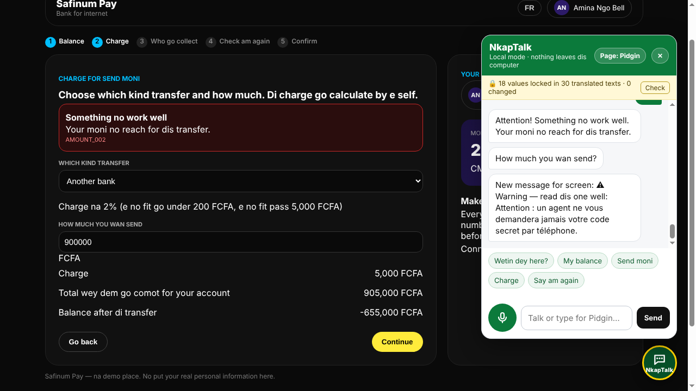

<div align="center">

# NkapTalk

**Use your bank in Cameroonian Pidgin, by voice, with every amount kept exactly right.**

*Built for the SAFINUM Innovate Challenge 2026 (Yaoundé)*



</div>

---

## What is NkapTalk?

Most banking and mobile money apps in Cameroon only speak French or English. NkapTalk is a **Chrome extension** that sits on top of an online banking page, **without changing the bank's code**, and makes it usable in **Pidgin**:

| | What it does |
|---|---|
| 🌍 **Translates the page** | Buttons, labels, messages, errors and warnings switch to Pidgin as the page loads, including text that appears later. |
| 🎙 **Talks with you** | Ask by voice or by typing ("How much moni dey my account?"). NkapTalk reads the screen aloud and walks you through a transfer, filling and clicking for you. |
| 🔒 **Never changes a value** | Amounts, fees, totals, phone numbers, references, account numbers and names are locked before translation and checked after. If anything differs, the original stays. |
| ✋ **Asks before money moves** | Before pressing *Confirm*, NkapTalk reads back the amount, fee, total, receiver and reference from the screen and waits for your "yes". It never touches your PIN. |

It works with or without internet AI: with no API key, everything runs on your computer.

---

## Contents

1. [Install](#1-install)
2. [First use](#2-first-use)
3. [Talking to NkapTalk](#3-talking-to-nkaptalk)
4. [Settings: local mode or Gemini](#4-settings-local-mode-or-gemini)
5. [Practise offline](#5-practise-offline)
6. [Safety and integrity](#6-safety-and-integrity)
7. [Privacy: what leaves your computer](#7-privacy-what-leaves-your-computer)
8. [How it works](#8-how-it-works)
9. [Run the tests](#9-run-the-tests)
10. [Improve the Pidgin](#10-improve-the-pidgin)
11. [Troubleshooting](#11-troubleshooting)
12. [Known limitations](#12-known-limitations)
13. [Components used](#13-components-used)

---

## 1. Install

You need **Google Chrome** (or another Chromium browser such as Edge or Brave) on a computer.

1. **Download the code**
   - Click the green **Code** button on this page, then **Download ZIP**, and unzip it.
   - Or with git: `git clone https://github.com/Serge-NSN/nkap-talk.git`
2. Open Chrome and go to **`chrome://extensions`**
3. Turn on **Developer mode** (switch at the top right).
4. Click **Load unpacked** and select the **`nkaptalk-extension`** folder (the folder that contains `manifest.json`).
5. The NkapTalk settings page opens. You can leave everything as it is and click **Save**. See [Settings](#4-settings-local-mode-or-gemini) to add a Gemini key later.
6. Optional: click the puzzle icon 🧩 in Chrome's toolbar and pin **NkapTalk**.

> **Updating:** after downloading a new version, go back to `chrome://extensions` and click the ↻ reload icon on the NkapTalk card.

## 2. First use

1. Open the SAFINUM test bank: **https://safinum.cm/hackathon-test**
2. The page switches to **Pidgin** by itself ("Moni wey dey your account", "Send moni", "Look di charge"...).
3. Click the green **NkapTalk** button at the bottom right (or press **Alt + Shift + P**).
4. NkapTalk greets you and tells you what is on the screen.
5. Press the **🎙 microphone** and speak, or type in the box and press **Enter**.
6. The first time you use the mic, Chrome asks for permission: click **Allow**.

## 3. Talking to NkapTalk

### Keyboard shortcuts

| Keys | Action |
|---|---|
| **Alt + Shift + P** | Open or close NkapTalk |
| **Alt + Shift + M** | Start talking (press again, or just stop speaking, to finish) |
| **Alt + Shift + T** | Switch the page between Pidgin and its original language |
| **Esc** | Stop NkapTalk talking |
| **Tab** | Move between NkapTalk's buttons (works with screen readers) |

### Things you can say

| You say | NkapTalk does |
|---|---|
| *"Wetin dey for screen?"* / *"Where I dey?"* | Reads the current screen in Pidgin |
| *"How much moni dey my account?"* | Reads your balance |
| *"Wetin I don spend last time?"* | Reads your recent transactions |
| *"Wetin be di charge for mobile money?"* | Opens the fees page and reads the fee rule |
| *"How much dem go cut if I send 20000?"* | Calculates the fees for that amount, from the page |
| *"I wan send 5000 give Ngwa Paul for mobile money"* | Starts a guided transfer with what you said |
| *"Yes"*, *"Na so"*, *"Oya do am"* | Says yes to NkapTalk's question |
| *"No"*, *"Wait"*, *"E no correct"* | Says no: nothing is done |
| *"Go front"* / *"Go back"* / *"Change am"* | Continue / back / edit |
| *"Say am again"* / *"Talk small small"* | Repeat / speak slower |
| *"Show di French"* / *"Put am for Pidgin"* | Page in original language / in Pidgin |

You can also use the quick buttons in the panel: **Wetin dey here?**, **My balance**, **Send moni**, **Charge**, **Say am again**.

### A guided transfer, step by step

```
You:      I wan send 5000 give Ngwa Paul for mobile money
NkapTalk: For 5 000 FCFA with Mobile Money: charge na 100 FCFA. Total wey dem go comot
          na 5 100 FCFA. Your balance after go be 244 900 FCFA. Make I go front?
You:      Yes
NkapTalk: Wetin be di phone number? Talk am one by one.
You:      Six seven seven double one two three four five
NkapTalk: Why you di send di moni? If you no wan talk am, say "skip".
You:      Skip
NkapTalk: Make we check am: di name na Ngwa Paul, di phone number na +237 6 77 11 23 45. Na correct?
You:      Na so
NkapTalk: Check am well. Amount na 5 000 FCFA. Charge na 100 FCFA. Total wey dem go comot
          na 5 100 FCFA. Di pesin wey go collect na Ngwa Paul, phone +237 6 77 11 23 45.
          Reference na SAF-2026-…  I go tick say all dis information correct, and press
          "Confirm di transfer". Make I send di moni?
You:      Yes
NkapTalk: Transfer don go! Status: E don work. … Reference na SAF-2026-…
```

If the bank shows an error (for example *insufficient balance*) or a security warning, NkapTalk reads it out at once and asks what to do next.

## 4. Settings: local mode or Gemini

Open the settings by right-clicking the NkapTalk icon → **Options**, or from `chrome://extensions` → NkapTalk → **Details** → **Extension options**.

| Mode | How to get it | What you get |
|---|---|---|
| **Local mode** (default, no key) | Nothing to do | Page translated from NkapTalk's built-in Pidgin phrasebook; typed requests understood offline; voice via Chrome's speech recognition |
| **Gemini mode** | Paste a Gemini API key | Better understanding of free speech (accents, mixed Pidgin/English/French); translation of brand-new text the phrasebook doesn't know |

**Getting a Gemini API key:** go to https://aistudio.google.com/apikey, sign in with a Google account, click **Create API key**, copy it into **Gemini API key** in NkapTalk's settings, then click **Save**.

Other settings:

- **Understand my voice with Gemini:** sends only your voice or typed words, never the screen.
- **Translate new text with Gemini:** sends only unknown text, with all values removed (see [Privacy](#7-privacy-what-leaves-your-computer)).
- **Use Gemini's voice for replies:** off by default, because it sends the reply text, which includes amounts.
- **Translate the page as soon as it opens**, **Browser voice** and **Speaking speed**.

## 5. Practise offline

The `practice-bank` folder holds an offline copy of the SAFINUM test page, with the same structure, texts (French and English), fee rules and errors. It also has a box to **inject a new message** the way the jury will.

```bash
cd practice-bank
python3 -m http.server 8000
```

Then open **http://localhost:8000** in Chrome with NkapTalk installed.

To test the "error" cases:

| Try this | You get |
|---|---|
| Amount `0` then Continue | `AMOUNT_001` amount must be greater than zero |
| Amount `900000` then Continue | `AMOUNT_002` insufficient balance |
| Continue on the beneficiary page without ticking the box | `SECURITY_001` security warning |
| Confirm on the summary without ticking the box | `CONFIRM_001` |

## 6. Safety and integrity

These rules are written in code. They don't depend on the AI behaving well.

- **Locked values.** Every amount, fee, total, percentage, phone number, reference, account number, error code, date and name you typed is detected and replaced by a placeholder before translation, then put back and compared. If anything changed, the original text is shown instead. The yellow bar in the panel shows the live count, e.g. *"🔒 19 values locked in 29 translated texts · 0 changed"*. Click **Check** to re-verify the whole page.
- **Ask before money moves.** NkapTalk never presses *Confirm* without first reading back the values **from the screen** and getting a clear "yes". "No" cancels.
- **Confirmation boxes** ("I have verified…", "I confirm…") are only ticked after your "yes".
- **No PINs or passwords.** NkapTalk refuses to fill password, PIN, OTP or code fields.
- **Unclear amounts are asked again.** Spoken amounts are produced by code, not by the AI: "5 100 FCFA" → *"five thousand, one hundred franc"*, phone numbers digit by digit, references letter by letter.
- **Warnings are never softened.** Known warnings use reviewed Pidgin. An unknown warning gets a Pidgin warning prefix **plus the exact original words**.
- **Banking only.** Off-topic questions get a polite fixed answer.

## 7. Privacy: what leaves your computer

The test rules say an extension must not collect, store or transmit the data displayed on the page.

| Feature | Sent | To |
|---|---|---|
| Page translation (phrasebook) | Nothing | — |
| Typed requests, local mode | Nothing | — |
| Microphone, local mode | Your voice only | Google, through Chrome's speech recognition |
| Gemini voice understanding | Your voice or typed words + NkapTalk's last question. **Never the screen.** | Google Gemini API |
| Gemini translation of new text | Only unknown text, with **every value replaced by ⟦1⟧, ⟦2⟧…** | Google Gemini API |
| Gemini voice (off by default) | The reply text, which contains values | Google Gemini API |

NkapTalk stores nothing. Names you type are kept in memory only (to protect them from translation) and disappear when the page closes. There are no analytics and no NkapTalk server.

## 8. How it works

```
          Bank page (unchanged)
     reads ▲            │ clicks / fills, like a person
           │            ▼
 ┌──────────────── NkapTalk extension (in the browser) ─────────────────┐
 │ values.js      find & lock amounts, phones, refs, codes, accounts,   │
 │                dates, names                                          │
 │ phrasebook.js  French/English → Pidgin (offline, reviewed)           │
 │ translator.js  translate in place, watch for new text, verify values │
 │ screen.js      find buttons, fields and values by their text         │
 │ nlu.js         understand Pidgin (offline rules, or Gemini)          │
 │ assistant.js   the conversation + guided transfer + safety rules     │
 │ speech.js      values → spoken words, voice out, microphone          │
 │ ui.js          floating button & panel (Shadow DOM, no style leaks)  │
 └──────────────────────────────┬───────────────────────────────────────┘
                                │ optional, masked
                        background.js ──► Google Gemini API
```

### Project layout

```
nkap-talk/
├── nkaptalk-extension/     ← load this folder in Chrome
│   ├── manifest.json
│   ├── background.js       only file that calls Gemini
│   ├── content/            everything that runs on the bank page
│   ├── options/            settings page
│   └── icons/
├── practice-bank/          offline copy of the SAFINUM test page
├── tests/                  unit tests + end-to-end test in Chrome
├── PIDGIN-REVIEW.md        every Pidgin line, for native-speaker review
└── README.md
```

## 9. Run the tests

```bash
# Unit tests (Node.js 18+)
node tests/test-phrasebook.js   # all 134 test-page strings (FR + EN) translated, 0 values changed
node tests/test-nlu.js          # 35 Pidgin requests, answers, and value-to-speech checks

# End-to-end: loads the real extension in Chrome and runs the full journey on the practice page
pip install playwright
python3 tests/e2e.py
```

The end-to-end test covers: dashboard, balance, off-topic refusal, fees, beneficiary, read-back, "no" cancels, confirm, receipt, insufficient-balance error, jury-injected messages, the English page, and the Pidgin/original toggle. All pass, with 0 values changed.

## 10. Improve the Pidgin

The Pidgin was written as a starting point and **must be checked by native speakers**.

1. Open **[PIDGIN-REVIEW.md](PIDGIN-REVIEW.md)**: every screen text, every sentence NkapTalk says, and the ways people ask.
2. Mark each line OK, or write a better version.
3. Apply fixes in `nkaptalk-extension/content/phrasebook.js` (screen text) and `nkaptalk-extension/content/assistant.js` (what NkapTalk says).
4. Add new ways of asking to `tests/test-nlu.js` and patterns to `nkaptalk-extension/content/nlu.js`.
5. Run the tests, reload the extension.

Keep `{1}`, `{2}`... exactly as they are in the phrasebook: they stand for amounts, names or numbers taken from the page.

## 11. Troubleshooting

| Problem | Fix |
|---|---|
| The NkapTalk button doesn't appear | Check the address is `https://safinum.cm/hackathon-test…` or `http://localhost…`. Reload the page. In `chrome://extensions`, check NkapTalk is on. |
| The page isn't in Pidgin | Press **Alt + Shift + T**, or click **Page: Original** in the panel. Check *Translate the page as soon as it opens* in settings. |
| The mic does nothing | Allow the microphone for the site (🔒 icon left of the address bar → Microphone → Allow). Or type instead. |
| "I no hear you well" | Speak a bit closer to the mic, or add a Gemini key for better understanding of accents. |
| The voice sounds very English | Pick another voice in settings (*Browser voice*), or turn on Gemini's voice (see privacy note). |
| Want it on another website | Add the site's address under `"matches"` in `nkaptalk-extension/manifest.json`, then reload the extension. |

## 12. Known limitations

- The Pidgin still needs review by native speakers (see [Improve the Pidgin](#10-improve-the-pidgin)).
- Voice output uses an English voice reading Pidgin spelling. Recorded native voice clips would be the next step.
- Offline understanding is rule-based and covers common phrasings, not every way of speaking. Gemini mode handles free speech.
- Local money slang for amounts isn't built in yet: NkapTalk asks again rather than guessing.
- Desktop Chrome only. The same engine can later power an Android app working over mobile money apps.
- The guided transfer follows the 5 steps of the SAFINUM test page. On other pages NkapTalk translates and reads the screen, but doesn't drive the flow.

## 13. Components used

| Component | Used for |
|---|---|
| Chrome Extensions API (Manifest V3) | Running on the page, settings |
| Web Speech API (built into Chrome) | Voice output; voice input in local mode |
| Google Gemini API: `gemini-2.5-flash`, optional `gemini-2.5-flash-preview-tts` | Understanding speech, translating new text (masked), optional voice |
| Our own code | Value locking, Pidgin phrasebook, screen reading, conversation, safety rules |

No third-party libraries are bundled in the extension. The end-to-end test uses [Playwright](https://playwright.dev).

---

<div align="center">

Made in Bamenda, Cameroon, by **Serge Ntunyu Ngala (NSN)** and team, for the **SAFINUM Innovate Challenge 2026**.

</div>
